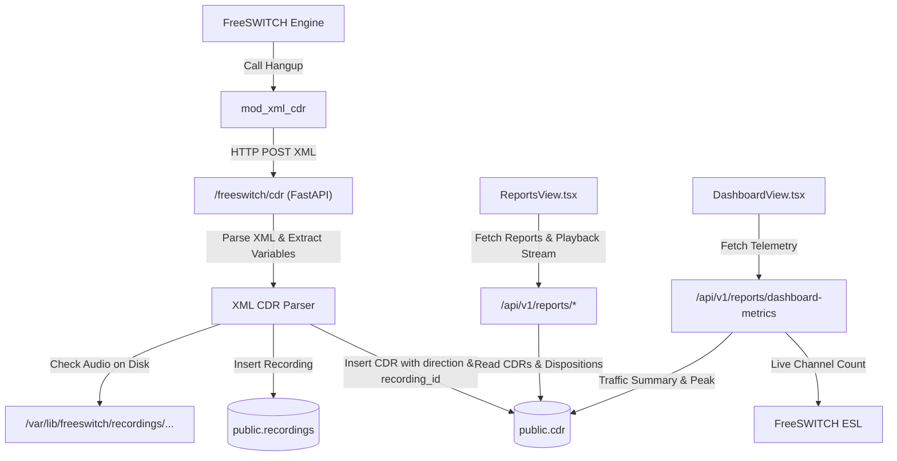

# Sub-Project 2: CDR Pipeline, Reports & Dashboard Telemetry Design Spec

## 1. Overview & Objectives
This specification covers Sub-Project 2 of the telephony improvements:
1. **FreeSWITCH `mod_xml_cdr` Integration**: Enable `mod_xml_cdr` to dump call detail records (CDRs) and call recording associations directly to the PostgreSQL database on call termination.
2. **Call Direction & Recording Linking**: Ensure every call record specifies `direction` (`inbound`, `outbound`, `internal`) and links to `recordings` for audio playback.
3. **Disposition Summary & Filtered Reports**: Provide a dedicated Disposition Summary tab with visual KPI metric cards (Answered, No Answer, Busy, Failed, Answer Rate %) and breakdown tables, plus a Call Direction filter on Call Detail Records.
4. **Dashboard Telemetry Fix**: Ensure Dashboard widgets (Traffic Summary, Traffic Peak, and Live Calls) display accurate real-time telemetry from database records and FreeSWITCH status.

---

## 2. Architecture & Data Flow



---

## 3. Subsystem Specifications

### 3.1 FreeSWITCH Configuration
- **`config/freeswitch/autoload_configs/modules.conf.xml`**:
  Add `<load module="mod_xml_cdr"/>` so the module loads automatically on startup.
- **`config/freeswitch/autoload_configs/xml_cdr.conf.xml`**:
  ```xml
  <configuration name="xml_cdr.conf" description="XML CDR Module">
    <settings>
      <param name="url" value="http://api:8000/freeswitch/cdr"/>
      <param name="retries" value="3"/>
      <param name="delay" value="0"/>
      <param name="log-b-leg" value="false"/>
      <param name="prefix-a-leg" value="false"/>
      <param name="encode" value="true"/>
    </settings>
  </configuration>
  ```

### 3.2 XML CDR Ingestion Endpoint (`src/xml_curl/router.py`)
- Accept both `application/x-www-form-urlencoded` (`cdr=<urlencoded_xml>`) and raw `text/xml` or `application/json`.
- Extract channel variables:
  - `uuid` -> `call_uuid`
  - `direction`: Evaluates `variables/direction` or `variables/call_direction`. If absent, infers from caller/destination length and SIP profile (`inbound`, `outbound`, `internal`).
  - `caller_id_number`, `caller_id_name`
  - `destination_number`
  - `tenant_id`: from `variables/tenant_id`, `variables/accountcode`, or domain lookup.
  - `start_epoch`, `answer_epoch`, `end_epoch` -> parsed to UTC datetimes.
  - `duration`, `billsec`
  - `hangup_cause`, `hangup_cause_q850`
  - `recording_file`: If present and file exists on disk, registers in `recordings` table and sets `recording_id`.
  - `voicemail_file`: If present and file exists, registers in `voicemail_messages`.
- Performs upsert into `public.cdr` keyed on `call_uuid`.

### 3.3 Backend Reports & Telemetry API (`src/api/v1/reports.py`)
1. **`GET /api/v1/reports/cdr`**:
   - Query filters: `tenant_id`, `start_date`, `end_date`, `call_type` (`all`, `inbound`, `outbound`, `internal`), `disposition` (`all`, `answered`, `no_answer`, `busy`, `failed`).
   - Returns itemized records with `recording_id`, `direction`, `duration`, `billsec`, `hangup_cause`, etc.
2. **`GET /api/v1/reports/disposition-summary`**:
   - Aggregates by disposition category:
     - `ANSWERED`: `billsec > 0`
     - `NO_ANSWER`: `billsec = 0` and cause in `('NO_ANSWER', 'NO_USER_RESPONSE', 'PROGRESS_TIMEOUT')`
     - `BUSY`: cause in `('USER_BUSY')`
     - `FAILED`: cause in `('CALL_REJECTED', 'DESTINATION_OUT_OF_ORDER', 'NORMAL_TEMPORARY_FAILURE', etc.)`
     - `CANCELLED`: cause in `('ORIGINATOR_CANCEL')`
   - Returns totals, answer rate percentage, and granular disposition breakdown.
3. **`GET /api/v1/reports/dashboard-metrics`**:
   - `traffic_summary`: Inbound and Outbound total, answered, unanswered, failed.
   - `traffic_peak`: Max hourly channel concurrency over past 30 days.
   - `live_calls`: Queries active channels via ESL `show channels count` with fallback.

### 3.4 Frontend UI Updates
1. **`PBX-frontend/src/components/ReportsView.tsx`**:
   - Add tab: `'disposition'` ("Disposition Summary") alongside Summary, CDR, Internal, Outbound, Recordings.
   - Add Direction filter dropdown (`All Directions`, `Inbound`, `Outbound`, `Internal`) in FilterBar.
   - Add Disposition filter dropdown (`All Dispositions`, `Answered`, `No Answer`, `Busy`, `Failed`).
   - Render KPI summary cards and disposition breakdown table in Disposition tab.
   - Render inline Audio Player and Play/Pause buttons in CDR tab when `recording_id` exists.
2. **`PBX-frontend/src/components/DashboardView.tsx`**:
   - Ensure Traffic Summary & Peak widgets dynamically reflect metrics from `getDashboardMetrics`.
3. **`PBX-frontend/src/services/api.ts`**:
   - Add `getDispositionSummaryReport(token, tenantId?, startDate?, endDate?, callType?)`.
   - Update `getCdrReport` to accept `callType` and `disposition`.

---

## 4. Verification Plan
- Unit test XML CDR parser with sample FreeSWITCH XML CDR payloads (inbound, outbound, internal).
- Unit test disposition summary and CDR filter queries.
- FreeSWITCH live verification: reload XML, verify `module_exists mod_xml_cdr` is true.
- Frontend build verification (`npm run build`).
