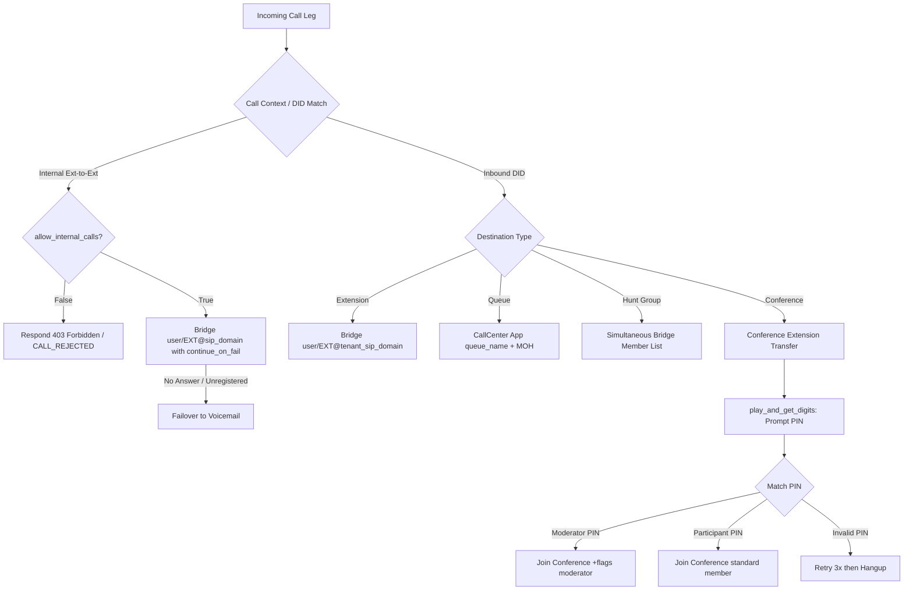

# Design Specification: Sub-Project 1 — Core Telephony, Dialplan & Call Routing Fixes

- **Date**: 2026-10-14
- **Scope**: Items 1, 2, 3, 4, 5 of FreeSWITCH PBX feature suite
- **Status**: Approved for Implementation Planning

---

## 1. Problem Statement & Motivation

1. **Internal Extension-to-Extension Calls Failing & Missing Policy Toggle (Item 1)**:
   - In `src/xml_curl/dialplan.py`, `check_registered_domain` uses a raw TCP socket to FreeSWITCH ESL port 8021, testing candidate domains (`127.0.0.1`, `domain_name`, `pbx.aikyamlabs.local`). If an extension registers with any other IP or domain, the check returns `None` and prematurely transfers the call to voicemail without ever attempting a bridge.
   - Administrators lack a tenant-level switch to enable or disable internal extension-to-extension calling.
2. **Call Center Module Not Preloaded & Missing Music on Hold (Item 2)**:
   - `mod_callcenter` is absent from `modules.conf.xml`. Attempting to load queues or route calls to queues fails.
   - Callers waiting in queues or on hold need native FreeSWITCH Music on Hold (`local_stream://moh`).
3. **Inbound DID Routing Fails on Extensions, Queues & Hunt Groups (Item 3 & 4)**:
   - Inbound carrier calls arrive in the `public` context. The dialplan bridges to `user/{target}@{domain_name}` where `domain_name` is the carrier's gateway/host IP, rather than the tenant's SIP domain where internal extensions are registered.
   - Hunt groups and callcenter queues are not properly resolved or dispatched.
   - Hunt group destination type is missing from the frontend inbound routing selectors.
4. **Conference Functionality & Dynamic PIN Dialplan (Item 5)**:
   - `mod_conference` is loaded, but lacks a dynamic dialplan flow prompting callers for a conference PIN, distinguishing between Moderator and Participant PINs, and supporting direct inbound DID routing into conference rooms.

---

## 2. Architecture & Detailed Design

### 2.1 FreeSWITCH Module Configuration & Music on Hold (Item 2)
- **Module Preloader**:
  In `config/freeswitch/autoload_configs/modules.conf.xml`, add `<load module="mod_callcenter"/>` inside the `<modules>` block.
- **Callcenter Autoload Configuration**:
  Create `config/freeswitch/autoload_configs/callcenter.conf.xml`:
  - Define default queue parameters:
    - `<param name="strategy" value="round-robin"/>`
    - `<param name="moh-sound" value="local_stream://moh"/>`
    - `<param name="record-template" value="/var/lib/freeswitch/recordings/${tenant_id}/${uuid}.wav"/>`
    - `<param name="time-base-score" value="system"/>`
  - Queues from the PostgreSQL `queues` table are dynamically served or reloaded via ESL / XML-CURL.
- **Music on Hold**:
  - `local_stream.conf.xml` defines `moh/8000`, `moh/16000`, etc., pointing to `$${sounds_dir}/music/8000`.
  - Dialplan uses `local_stream://moh` for queue hold, conference hold, and valet parking.

### 2.2 Internal Extension Calling Engine & Enable/Disable Policy (Item 1)
- **Eliminate Brittle Pre-check**:
  - Remove `check_registered_domain` from `src/xml_curl/dialplan.py`.
  - Rely on FreeSWITCH native Sofia registration database: bridge directly to `[leg_timeout={timeout}]user/{ext_num}@{callee_domain}`.
  - Set `continue_on_fail=true` with complete failure cause list (`USER_BUSY`, `NO_ANSWER`, `USER_NOT_REGISTERED`, etc.) and `transfer_on_fail={fail_target} XML {context}`. If the phone is unregistered or unanswered, FreeSWITCH cleanly transfers to `voicemail_{ext_num}` or forward target.
- **Policy Toggle**:
  - Add `allow_internal_calls` (BOOLEAN, DEFAULT TRUE) column to `tenants` table.
  - In `src/xml_curl/dialplan.py`, before processing extension-to-extension dialing:
    - If `allow_internal_calls` is `false` for the tenant:
      FreeSWITCH executes `<action application="respond" data="403 Forbidden - Internal Calling Disabled"/>` followed by `<action application="hangup" data="CALL_REJECTED"/>`.
  - In frontend `RoutingView.tsx`, add an "Internal Extension Calling" toggle card allowing tenant admins to enable or disable internal calling with immediate API synchronization.

### 2.3 Inbound DID Routing Engine (Items 3 & 4)
- **Inbound DID Ingestion**:
  - In `src/xml_curl/dialplan.py`, match incoming `destination_number` against `call_routes` (`route_type = 'inbound_did'`) and `dids`.
  - Extract `tenant_id`, tenant's `sip_domain`, `destination_type`, and `destination_target`.
- **Destination Handlers**:
  1. `extension`:
     - Bridge to `[leg_timeout=25]user/{target}@{tenant_sip_domain}`.
     - Fallback on no-answer to `voicemail_{target}`.
  2. `queue`:
     - Execute FreeSWITCH callcenter app: `<action application="callcenter" data="{target_queue_name}"/>`.
  3. `hunt_group`:
     - Fetch `hunt_groups` record by target.
     - Parse member extensions and bridge simultaneously: `[leg_timeout={timeout}]user/{ext1}@{tenant_sip_domain},user/{ext2}@{tenant_sip_domain}`.
     - Fallback on timeout to hunt group voicemail or configured fallback.
  4. `conference`:
     - Transfer caller directly to conference extension: `<action application="transfer" data="{conf_ext} XML {context}"/>`.
- **Frontend Routing UI**:
  - In `RoutingView.tsx` and `DidsView.tsx`, add "Hunt Group" and "Conference" to destination type options, fetching available hunt groups and conference rooms for selection.

### 2.4 Conference Dialplan & Dynamic PIN Authentication (Item 5)
- **Dialplan Extension**:
  - Matches conference `extension_number` from `conferences` table for the tenant.
- **PIN Prompt Flow**:
  - Answer channel.
  - Execute `play_and_get_digits`:
    - Min digits: 1, Max digits: 10, Timeout: 5000ms, Terminator: `#`.
    - Prompt audio: `conference/conf-pin.wav` (or fallback beep).
    - Variable: `conf_entered_pin`.
- **Role Verification**:
  - If `conf_entered_pin == moderator_pin`:
    - Enter room with moderator privileges:
      `<action application="conference" data="{conf_name}@default+flags{moderator}"/>`.
  - Else if `conf_entered_pin == pin` (participant PIN):
    - Enter room as standard participant:
      `<action application="conference" data="{conf_name}@default"/>`.
  - Else:
    - Play bad PIN prompt (`conference/conf-bad-pin.wav`), retry up to 3 times, then `<action application="hangup" data="CALL_REJECTED"/>`.
- **Conference Recording & Tracking**:
  - If `record_conference == true`, execute `record_session /var/lib/freeswitch/recordings/{tenant_id}/conf_{conf_id}_{uuid}.wav`.
  - Track participant in `conference_participants` table and tag `conference_id` in CDR.

---

## 3. Data Flow Diagram

---

## 4. Verification & Testing Plan
1. **Module & MOH Verification**:
   - Reload FreeSWITCH configs; execute `fs_cli -x "module_exists mod_callcenter"` and `fs_cli -x "callcenter_config queue list"`.
   - Test MOH via feature code `*95` (`local_stream://moh`).
2. **Internal Calling Test**:
   - Make call between 1001 and 1002 with `allow_internal_calls = true` -> verifies immediate ring and connection without offline errors.
   - Toggle `allow_internal_calls = false` in Routing View -> call is rejected with SIP 403 Forbidden.
3. **Inbound DID Routing Test**:
   - Route DID to extension -> verifies callee phone rings.
   - Route DID to queue -> verifies caller hears MOH and enters queue.
   - Route DID to hunt group -> verifies simultaneous ringing of member extensions.
   - Route DID to conference -> verifies prompt for PIN.
4. **Conference Authentication Test**:
   - Dial conference room with participant PIN -> caller enters conference room as participant.
   - Dial conference room with moderator PIN -> caller enters with moderator controls.
   - Enter invalid PIN -> caller receives retry prompt, then hangup after 3 invalid attempts.
