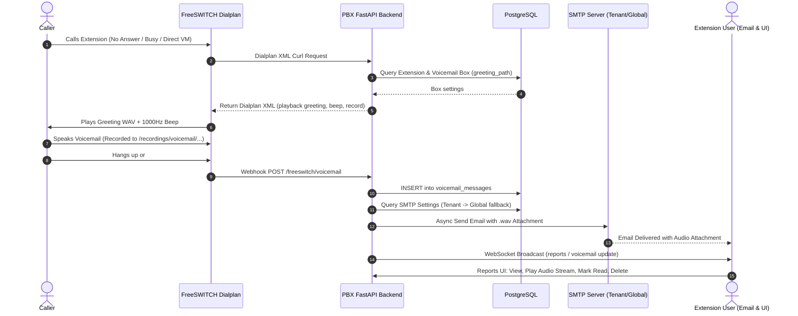

# Sub-Project 3: Voicemail System, Custom Prompts & Notifications Design Specification

**Date:** 2026-10-14  
**Status:** In Review  
**Sub-Project:** 3 of 4 (Items 4, 9, 12)  
**Authors:** AI Engineering Lead & PBX Telephony Team  

---

## 1. Overview & Goals

Sub-Project 3 delivers an end-to-end Voicemail, Audio Prompts, and Email Notification subsystem for the FreeSWITCH Multi-Tenant PBX:
1. **Voicemail Ingestion & Greeting Playback (Item 4)**:
   - When a call to an extension is unanswered, busy, or forwarded to voicemail:
     - FreeSWITCH answers the call cleanly.
     - Plays the custom extension greeting if configured in `voicemail_boxes.greeting_path` and present on disk; otherwise falls back to the dynamic TTS greeting synthesized by `ensure_voicemail_prompt(ext_num)` ("User at extension {ext} is not available, please leave a voice message after the beep.").
     - Plays 1000Hz beep tone (`tone_stream://%(500,0,1000)`).
     - Records caller message to `/var/lib/freeswitch/recordings/voicemail/<target>_<uuid>.wav` (up to 120s, silence terminate 4s).
     - Fires webhook (`/freeswitch/voicemail`) via hangup hook or post-record action to save metadata into `voicemail_messages` and `voicemail_boxes`.
2. **Dedicated Voicemail Tab in Reports (Item 4)**:
   - Add a dedicated `'voicemail'` tab to `PBX-frontend/src/components/ReportsView.tsx`.
   - Display summary KPI cards: Total Voicemails, Unread Messages, Total Duration, Active Mailboxes.
   - Itemized message table with caller ID name/number, extension, timestamp, duration, and read status badge.
   - Interactive actions: inline streaming audio player, toggle read/unread status, and delete message.
   - Real-time updates via WebSockets.
3. **Custom Audio Prompts Management (Item 9)**:
   - Verify upload of `.wav` and `.mp3` audio files via `src/api/v1/audio.py` (`/audio/upload`).
   - Browser streaming preview via `GET /audio/{id}/stream`.
   - Direct association of uploaded prompts with IVR menus and extension voicemail greeting (`voicemail_boxes.greeting_path`).
4. **Voicemail Email Notification Delivery (Item 12)**:
   - Hierarchical SMTP resolution: tenant-specific SMTP settings if configured, fallback to global PBX SMTP settings.
   - Asynchronous background email delivery with HTML template.
   - MIME multipart attachment of the recorded `.wav` file (`audio/wav`) encoded in base64.
   - Error handling and delivery logging.

---

## 2. Architecture & Data Flow

---

## 3. Detailed Component Design

### 3.1 Dialplan Voicemail Block (`src/xml_curl/dialplan.py`)
- Enhance `add_voicemail_block(cond_elem, ext_num, domain, tenant_id)`:
  - Query DB for custom `greeting_path` in `voicemail_boxes`.
  - If a valid custom audio file exists, use it: `<action application="playback" data="{custom_path}"/>`.
  - If no custom file is set or file is missing, synthesize/fetch prompt via `ensure_voicemail_prompt(ext_num)`: `<action application="playback" data="{prompt_path}"/>`.
  - Beep tone: `<action application="playback" data="tone_stream://%(500,0,1000)"/>`.
  - Record: `<action application="record" data="{vm_file} 120 200 4"/>`.
  - Hangup hook: `api_hangup_hook=curl http://api:8000/freeswitch/voicemail?... post`.

### 3.2 Voicemail Ingestion & Email Dispatch (`src/xml_curl/router.py` & `src/core/email_service.py`)
- Webhook `/freeswitch/voicemail`:
  - Inserts record into `voicemail_messages` linked to `voicemail_boxes`.
  - Dispatches background task `send_voicemail_notification(...)`.
- `send_voicemail_notification`:
  - Calls `get_smtp_settings(tenant_id)`.
  - If SMTP is configured, constructs MIME message with `.wav` attachment and sends via `smtplib` in `asyncio.to_thread`.
  - If SMTP is unconfigured or fails, logs structured diagnostic warning without crashing the call flow.

### 3.3 Frontend Voicemail Tab in `ReportsView.tsx`
- Tab selection: add `'voicemail'` to `activeTab` union.
- Tab bar: Add button for `Voicemail` with Lucide icon `Voicemail`.
- Data loading: Call `apiService.getVoicemailReport(token, selectedExt, isRead, startDate, endDate)`.
- KPI StatCards:
  - Total Voicemails
  - Unread Messages (highlighted in primary theme color)
  - Total Duration (formatted minutes/seconds)
  - Mailboxes Count
- DataTable Columns:
  - Extension (`mailbox` / `extension_number`)
  - Caller ID Name & Number
  - Timestamp (`created_at`)
  - Duration (formatted `mm:ss`)
  - Status (Badge: Unread in warning/amber, Read in subtle neutral)
  - Audio Player & Controls (Inline Play/Pause streaming from `/api/v1/reports/voicemail/{id}/audio`)
  - Actions: Mark Read/Unread, Download, Delete
- Zero inline styles (`style={{`), strictly conforming to the PBX Design System.

---

## 4. Testing Strategy

1. **Unit Tests**:
   - `tests/test_voicemail_dialplan.py`: Verify generated dialplan XML includes greeting playback, beep tone, record command, and hangup hook.
   - `tests/test_voicemail_ingestion.py`: Verify `/freeswitch/voicemail` webhook inserts into DB and triggers email worker.
   - `tests/test_email_service.py`: Verify MIME multipart creation, `.wav` attachment base64 encoding, and fallback from tenant to global SMTP.
2. **Frontend Verification**:
   - Run `npm run build` in `PBX-frontend` to verify 0 Design System violations and 0 TypeScript errors.
   - Verify all tab transitions, table rendering, and audio controls.
3. **Integration Verification**:
   - Live curl test of `/freeswitch/voicemail` webhook with simulated recording file.
   - Verify message appears in `GET /api/v1/reports/voicemail`.
   - Verify audio streaming endpoint `GET /api/v1/reports/voicemail/{id}/audio`.
   - Verify read status toggle and message deletion.
